# Arcade-TrioThePunch_MiSTer

FPGA core for **Trio The Punch — Never Forget Me…** (Data East, 1989)
targeting the [MiSTer FPGA](https://github.com/MiSTer-devel) platform
(Terasic DE10-Nano).

Trio The Punch is a quirky **arcade beat'em up** running on
**Data East DEC0 hardware** (sister board of Act-Fancer / Robocop /
Bad Dudes / Sly Spy / Heavy Barrel).

## Status

**Current version: 1.0** (July 2026).

The core runs the full game with audio and inputs, tested on real MiSTer
hardware.

**Features**
- HuC6280 main CPU @ 7.159 MHz (HUC6280 VHDL core)
- M6502 sound CPU @ 1.5 MHz (T65 VHDL core)
- YM2203 OPN + YM3812 OPL2 + OKI M6295 ADPCM, MAME-accurate clocks
  (OKI @ 1.056 MHz **verified on PCB**, MAME triothep)
- 256×240 active video area, 57.45 Hz refresh (hardware-accurate)
- 2 BAC06 tile layers with **per-row scroll** (PF0 16×16 background + PF1 8×8 characters)
- DECO MXC06 sprite chip (16×16, palette-banking, priority)
- Per-channel audio mixer in OSD (YM2203 / YM3812 / OKI ADPCM gain, 8-bit Q4.4 on OKI)
- **Analog VGA H-Shift / V-Shift** OSD options for fine alignment on 15 kHz CRTs
- **CRT Stretch** OSD option (analog horizontal pixel stretch for CRTs), core-side — see note below
- Pause overlay with logo + supporters scroll
- Hardware-accurate DIP switches

**ROM sets supported**
- Trio The Punch — Never Forget Me… (`triothep`, World)
- Trio The Punch — Never Forget Me… (`triothepj`, Japan) — merged ROM

## Screenshots

| | |
|---|---|
| 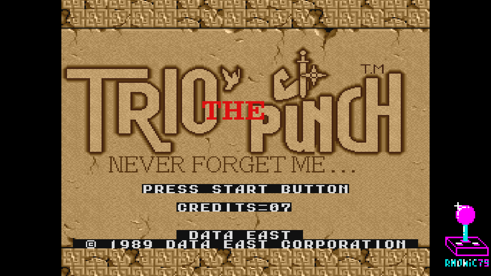 | 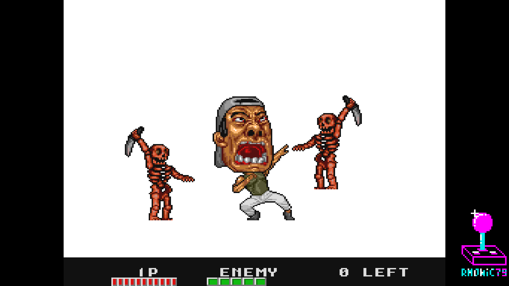 |
| Title screen | "Never Forget Me…" |
| 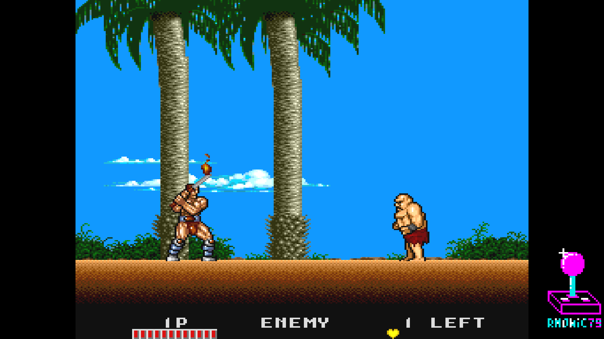 | 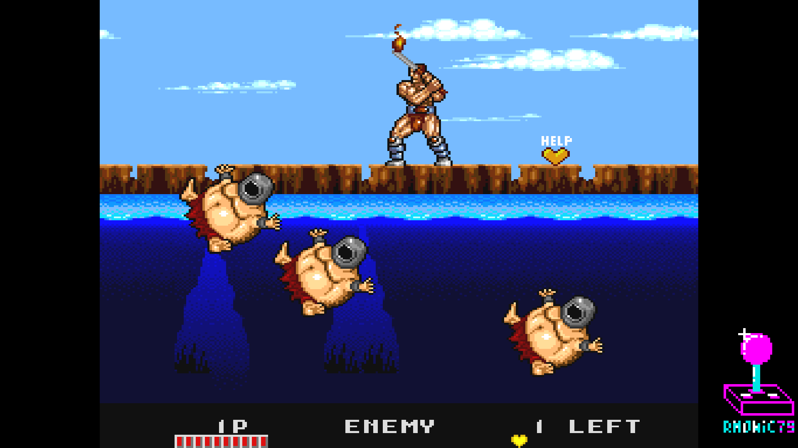 |
| Warrior stage | Warrior — combat |
| 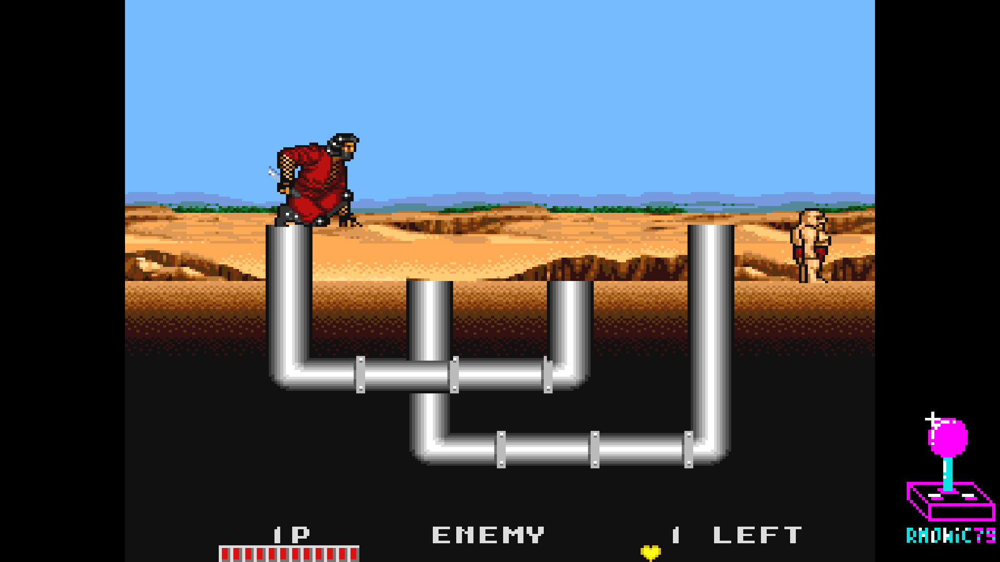 | 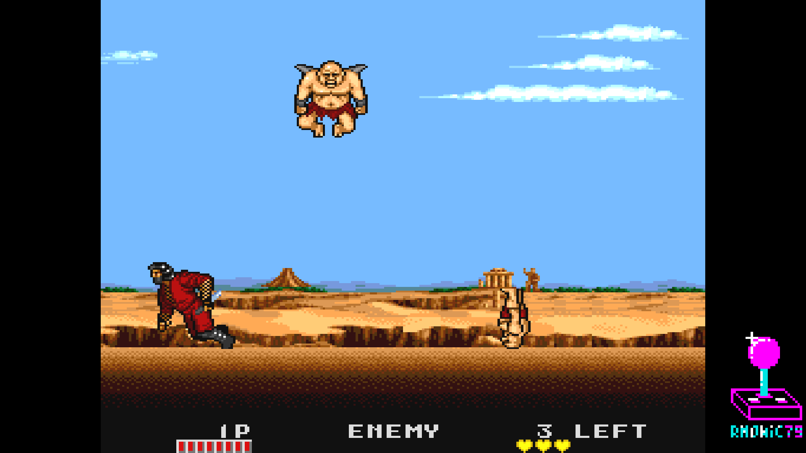 |
| Ninja stage | Ninja — combat |
| 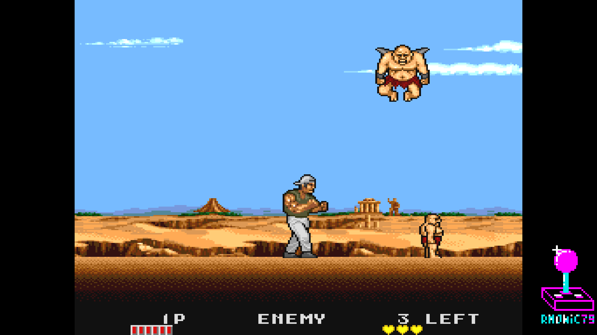 | 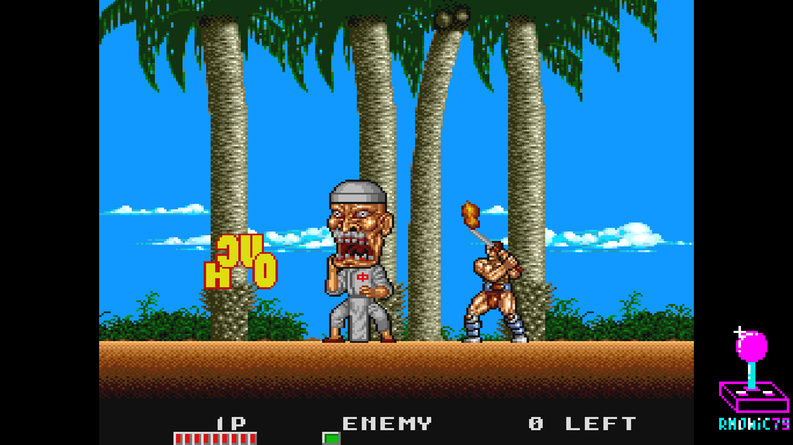 |
| Boxer | Boss fight |
| 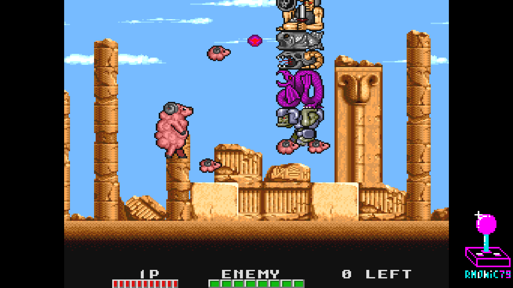 | 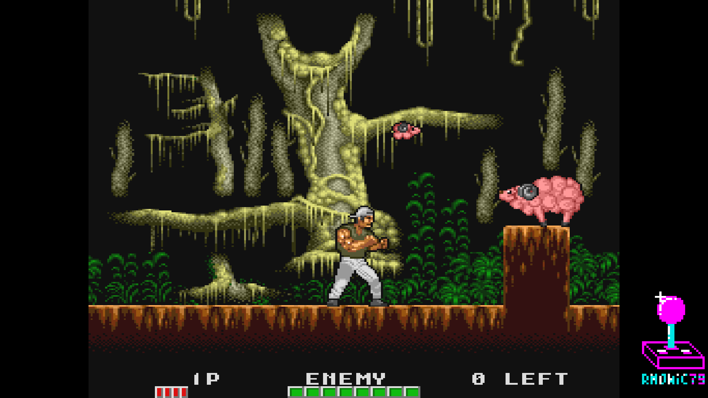 |
| Sheep | Sheep — the punch |
| 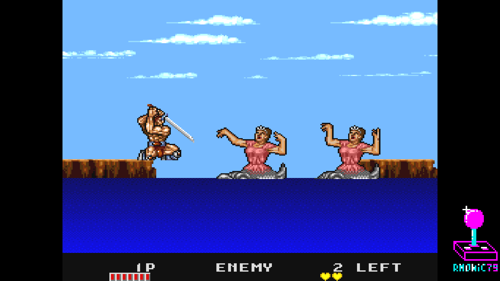 | 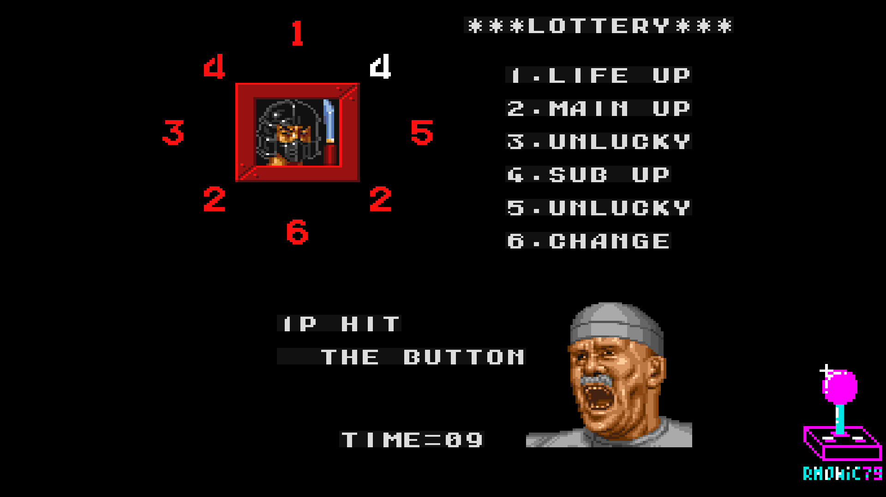 |
| Fish transformation | Bonus slot |
| 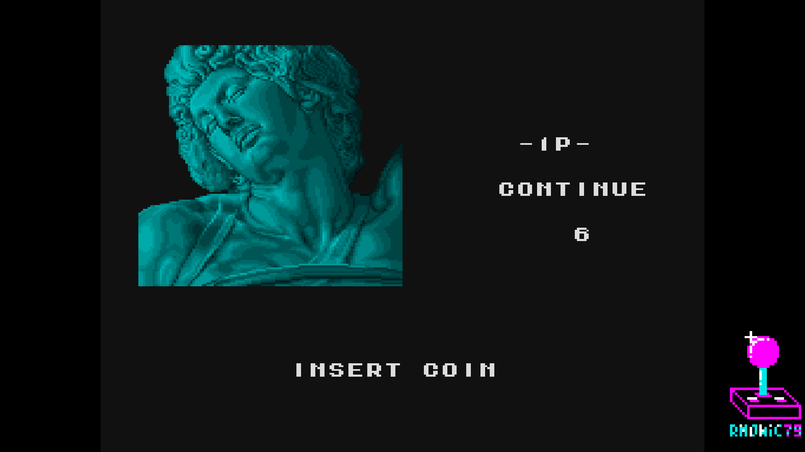 | |
| Continue screen | |

## Hardware emulated

| Component        | Spec                                                |
|------------------|-----------------------------------------------------|
| Master clock     | 21.477272 MHz crystal (main CPU XIN, verified PCB)  |
| Main CPU         | HuC6280 @ 7.159 MHz (XTAL / 3)                      |
| Sound CPU        | M6502 @ 1.5 MHz (XTAL 12 / 8, verified PCB)         |
| Sound chip 1     | Yamaha YM2203 (OPN) @ 1.5 MHz (jt03, verified PCB)  |
| Sound chip 2     | Yamaha YM3812 (OPL2) @ 3.0 MHz (jtopl2, verified PCB)|
| Sound chip 3     | OKI M6295 (jt6295) @ 1.056 MHz, pin7=HIGH (verified PCB) |
| Video resolution | 256×240 active                                      |
| Pixel clock      | 6.000 MHz (96 MHz / 16)                             |
| HTotal / VTotal  | 384 / 272                                           |
| Refresh rate     | 57.45 Hz (6 MHz / 384 / 272, hardware-accurate)     |
| PF0 (BG)         | 16×16 4bpp tile layer with row scroll (BAC06)       |
| PF1 (FG / chars) | 8×8 4bpp tile layer with row scroll (BAC06)         |
| Sprites          | 16×16 4bpp, MXC06 sprite chip                       |
| Palette          | xBGR_555, 1024 entries                              |

## A note on the CRT Stretch (analog H-Size) implementation

The core includes a custom **analog horizontal pixel-stretch** module,
originally released as a standalone reusable module:

- Repository: [MiSTer-AnalogHSize](https://github.com/rmonic79/MiSTer-AnalogHSize)

A cleaner approach exists as a module inside `sys_top`, where only the analog
DAC is stretched and the HDMI output stays untouched. Per the MiSTer-devel
guidelines the framework (`sys/`) must not be modified, so this core does not
use that approach for the official release.

Instead, CRT Stretch here is implemented **core-side**
(`rtl/actfancer/analog_hsize.sv`, zero `sys_top` changes), which keeps the core
compliant with the MiSTer-devel rules. The trade-off is that the stretch is
applied to the whole video path: **while CRT Stretch is active you cannot have a
clean HDMI output at the same time as the horizontal resize** — HDMI follows the
stretch too. The stretch itself is integer and line-buffered, so it is **free of
shimmering or scaling artifacts** on the analog output. Leave CRT Stretch Off
(default) for an untouched HDMI image.

Controlled by two OSD entries: **CRT Stretch** (Off/On, default Off) and, once
On, **CRT Stretch Amount** (0..5, progressively wider analog viewport). Because
the stretch grows the image rightward, the **Analog VGA H-Shift** range is
biased toward the left so you can re-center the stretched image.

## Hardware requirements

- Terasic DE10-Nano
- MiSTer I/O board (recommended)
- Works on HDMI displays and on 15 kHz CRTs via the analog video output

## Building from source

Requires Quartus Prime 17.0 (free Lite Edition).

```
Open TrioThePunch.qpf in Quartus → Processing → Start Compilation
```

Output bitstream is generated in `output_files/TrioThePunch.rbf` (~3.8 MB);
rename it to `TrioThePunch_YYYYMMDD.rbf` for the release.

## Running on MiSTer

The [releases/](releases/) folder contains the parent MRA and a prebuilt RBF;
the regional clone MRA is in [releases/alternatives/](releases/alternatives/):

- `Trio The Punch (World).mra` — parent MRA
- `TrioThePunch_YYYYMMDD.rbf` — prebuilt bitstream
- `alternatives/Trio The Punch (Japan).mra` — Japan regional clone

Steps:

1. Copy the `.rbf` to `_Arcade/cores/` on the MiSTer SD card.
2. Copy the `.mra` file(s) to `_Arcade/` on the MiSTer SD card.
3. Provide your legally-owned `triothep.zip` (or `triothepj.zip`) where the
   MRA expects it (usually in `games/mame/`).

**ROMs are NOT included in this repository.** You must provide them yourself.

## Repository layout

```
Arcade-TrioThePunch_MiSTer/
├── rtl/
│   ├── actfancer/    Shared DEC0 core RTL (Act-Fancer + Trio The Punch)
│   ├── HUC6280/      HuC6280 main CPU (VHDL)
│   ├── pll/          Clock PLL
│   ├── sound/        Sound chip cores (jt03, jtopl, jt6295, t65)
│   ├── common/       Shared utilities (BRAM ROMs, DDRAM bridge)
│   └── sdram.sv      SDRAM controller (Sorgelig)
│   (analog_hsize.sv — core-side CRT Stretch — lives under rtl/actfancer/)
├── sys/              MiSTer framework (Sorgelig / MiSTer-devel), UNMODIFIED
├── jtframe/          JTFRAME framework modules
├── logo/             Pause overlay assets (font, logo, supporter list)
├── releases/         Parent MRA + Japan clone + prebuilt RBF
├── TrioThePunch.qpf  Quartus project
├── TrioThePunch.qsf  Quartus assignments
├── TrioThePunch.sv   Top-level wrapper
├── Template.sdc      Timing constraints
├── files.qip         HDL file list
├── build_id.v        Build version stamp
└── README.md         This file
```

## Acknowledgements

- **Jose Tejada** ([@jotego](https://github.com/jotego)) for JT03 (YM2203),
  JTOPL (YM3812), JT6295 (OKI M6295), `jtcop_bac06` (DECO tilemap), `jtcop_obj`
  (DECO sprites) and the JTFRAME framework.
- **Daniel Wallner** for the T65 (6502) core.
- **Mike Johnson / Wolfgang Scherr** and others for the HUC6280 VHDL core.
- **Sorgelig** and the **MiSTer-devel team** for the framework, SDRAM
  controller and Template.
- **Andrea Bogazzi** ([@asturur](https://github.com/asturur)) for help with the
  core-side Analog H-Size implementation.

## Support this project

If you enjoy this core and want to support its development:

- [Ko-fi](https://ko-fi.com/ibecerivideoludici) — one-time support
- [Patreon](https://www.patreon.com/IBeceriVideoludici) — monthly support
- [PayPal](https://www.paypal.me/IBeceriVideoludici) — one-time donation

## Follow

- [GitHub](https://github.com/rmonic79)
- [Twitch](https://twitch.tv/ibecerivideoludici) — live streams
- [YouTube](https://www.youtube.com/c/IBeceriVideoludici) — playlists and videos
- [X / Twitter](https://x.com/rmonic79)

## License

The RTL source code in this repository is provided as-is for educational
and preservation purposes under **GNU GPL v3 or later**. Original ROM data
is not included; users must provide their own legally obtained copies.

Original *Trio The Punch — Never Forget Me…* arcade hardware © Data East
Corporation, 1989.
